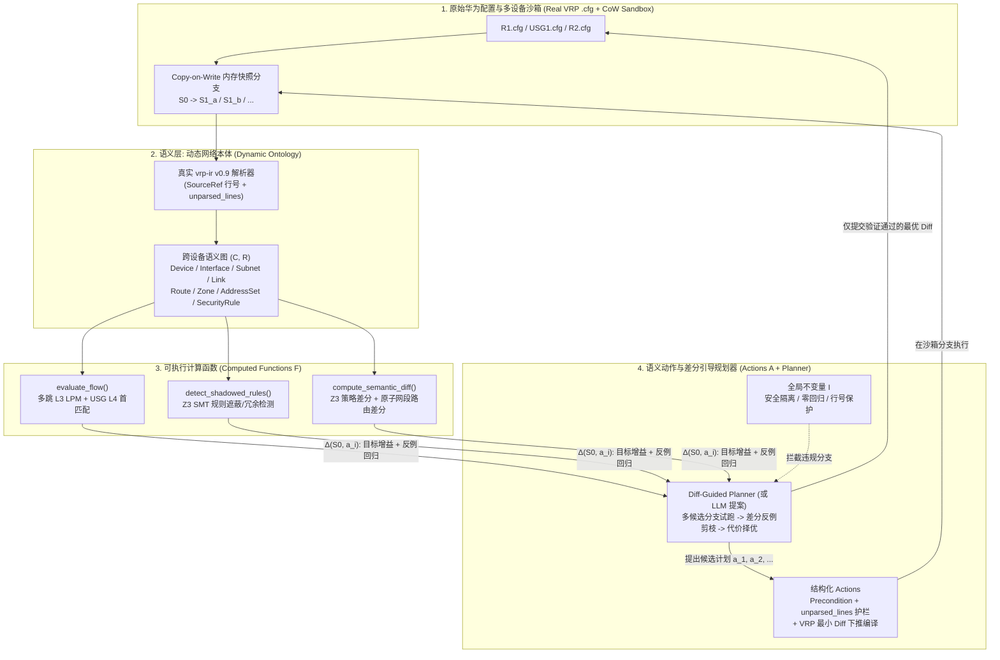

# 华为网络可执行动态本体（Executable Dynamic Ontology）可行性验证与技术规划方案

> **目标定位**：以华为 VRP 网络配置（路由器 + USG 防火墙）为基础，构建**可执行动态本体**原型，验证“**语义层（`vrp-ir` / Batfish VI）+ 计算函数（Functions）+ 语义动作（Actions）+ 差分效果（Differential Effects）+ 差分引导规划（Diff-Guided Planning）**”范式的可行性，并突出其相较于传统纯 LLM / 静态知识图谱 / 裸工具调用方案的核心优势。

---

## 一、核心概念创新（为什么需要“动态本体”？）

传统网络自动化存在三重割裂：
1. **静态知识图谱（Static KG）只回答“现在配了什么”**：能查询设备、接口和策略关系，但无法回答“如果把第 48 行规则改掉，全网哪些流量会从通变断、哪些数据库会被意外暴露？”
2. **纯 LLM / 裸 ReAct 工具调用缺乏“变更后果语义”与“沙箱回溯”**：模型改完配置后通常只做单点 `ping` 检查目标通没通，极易出现**“修 A 坏 B（Regression）”**、盲目放宽安全策略、或误改解析器未覆盖的现网配置。
3. **重型验证器（如 Batfish）不支持华为 VRP，且缺少字段级行号溯源**：难以直接闭环指导对华为现网 `.cfg` 的最小化安全微创修改。

本方案提出将**动态网络本体**定义为可执行的六元组：

$$\mathcal{O}_{\text{dyn}} = \langle \mathcal{C},\ \mathcal{R},\ \mathcal{F},\ \mathcal{A},\ \mathcal{I},\ \Delta \rangle$$

| 符号 | 组成部分 | 核心含义与工程落地 |
|---|---|---|
| $\mathcal{C}, \mathcal{R}$ | **语义层（Semantic Layer）** | 基于 `vrp-ir`（未来对齐 Batfish VI 模型）将多台华为 `.cfg` 解引用为跨设备统一语义图：`Device`, `Interface`, `Subnet`, `Link`, `StaticRoute`, `FirewallZone`, `AddressSet`, `ServiceSet`, `SecurityRule`，并保留精确 `SourceRef(file:line)` 与受保护的 `unparsed_lines` |
| $\mathcal{F}$ | **计算函数（Computed Functions）** | 挂接在本体的虚拟可执行函数：多跳 L3 LPM + USG L4 策略可达性评估 `evaluate_flow()`、Z3 策略遮蔽检测 `detect_shadowed_rules()`、安全基线检查 `audit_compliance()` |
| $\mathcal{A}$ | **语义动作（Structured Actions）** | 将底层文本编辑提升为带前置条件（Precondition）、参数校验、`unparsed_lines` 护栏与可逆编译（Lowering）的语义操作：`FixStaticRouteNextHop`, `AddStaticRoute`, `InsertSecurityRule`, `ModifySecurityRuleAction`, `DeleteSecurityRule` |
| $\mathcal{I}$ | **全局不变量（Invariants）** | 必须始终成立的业务与安全硬约束：例如 `DENY(Untrust -> DB:3306)`、无路由环路、`unparsed_lines` 零修改、关键现网业务零中断 |
| $\Delta(S, a)$ | **差分效果（Differential Effect）** | 在**内存 Copy-on-Write 沙箱**中执行动作 $a$ 后，由 Z3 SMT + 原子网段切分计算出的语义状态差：$\Delta = \langle \text{Target Gain},\ \text{Regression Counterexamples},\ \text{Rule Shadow Diff},\ \text{SourceRef Attribution} \rangle$ |

> **关键方法论亮点 — 不完全解析下的安全规划（Partial Grounding Soundness）**：  
> 现实中没有任何解析器能覆盖 100% 华为 VRP 命令。本方案不回避解析盲区，而是将 `vrp-ir` 显式报告的 `unparsed_lines` 建模为本体中的**受保护帧（Protected Frame）**，在动作前置条件和下推编译层硬性拦截对其的修改，保证系统“宁可声明边界，绝不盲改未知现网配置”。

---

## 二、系统架构与沙箱差分规划闭环

---

## 三、如何直观证明“动态本体相比传统方案的优势”？

### 对比维度总览

| 方案 | 能否跨设备关联 | 能否预测副作用（防修 A 坏 B） | 能否自动剪枝违规候选方案 | 能否保护未解析行 | 变更代价优化 |
|---|---|---|---|---|---|
| **Baseline 1：纯 LLM 改配置** | 靠上下文猜测 | ❌ 改完盲目自信 | ❌ 无沙箱 | ❌ 经常重写/误删 | ❌ 差 |
| **Baseline 2：LLM + 静态知识图谱** | ✅ 可查关系 | ❌ 无动态计算与差分 | ❌ 无动作推演 | ⚠️ 仅静态提示 | ❌ 差 |
| **Baseline 3：LLM + 裸 ReAct 工具** | ⚠️ 碎片化单点工具 | ⚠️ 仅测单个 `ping`，易漏副作用 | ❌ 单线试错、易改坏再补 | ⚠️ 靠 Prompt 约束 | ❌ 往往越加越乱 |
| **Ours：可执行动态本体 + 差分规划** | ✅ 统一语义图 + 行号溯源 | ✅ **Z3 + 原子网段全空间差分** | ✅ **沙箱分支 + 反例自动剪枝** | ✅ **前置条件硬拦截** | ✅ **多可行方案按代价择优** |

### 3 个精选核心验证场景（3 设备：`R1 — USG1 — R2`）

1. **场景 1 · 安全与连通冲突（一锤定音：防“修 A 坏 B”）**
   - **拓扑**：`Web/Untrust (10.1.0.0/24)` — `R1` — `USG1 防火墙` — `R2` — `App (10.2.0.10:443)` & `DB (10.2.0.20:3306)`。
   - **任务**：打通 `Web (10.1.0.10) → App (10.2.0.10:443)`；
   - **不变量**：严禁 `Untrust (10.1.0.0/24)` 访问 `DB (10.2.0.20:3306)`，且禁止改动 `R1` 末尾未解析的 `ospf` 行。
   - **动态本体规划过程**：
     - 候选计划 A（偷懒放宽 `USG1` 的 `deny` 规则为 `permit any`）→ 沙箱执行后 **Z3 语义差分瞬间报红**，吐出精确反例 `10.1.0.99 -> 10.2.0.20:3306 (TCP)` 由 `DENY` 变为 `PERMIT`（违背安全不变量），**自动回滚剪枝**；
     - 候选计划 B（修复 `R1` 路由 + 在 `USG1` 精准插入仅放行 `web-clients -> app-servers:https` 的最小权限规则）→ **差分验证全绿**（目标流 `FAIL→OK`，DB 隔离 `0` 破坏，`unparsed_lines` `0` 触碰）→ 提交生效！
2. **场景 2 · 跨设备三点耦合故障（L3 路由 + L4 防火墙联合定位与多步规划）**
   - **故障**：`R1` 静态路由下一跳写错 + `USG1` 前置旧规则 `legacy-block-app` 误拦截 HTTPS + `R2` 缺少回程路由。
   - **价值**：统一动态本体一次跨 3 台设备串出完整因果链，规划出 3 步原子动作序列，并在沙箱中一次性验证双向端到端可达与全网零回归。
3. **场景 3 · 策略遮蔽与最小代价优化（从“修通”到“规划最优”）**
   - **故障**：`USG1` 中历史宽泛规则 `legacy-deny-all-web` 遮蔽了下方原本正确的 `allow-web-to-app` 规则。
   - **价值**：本体计算函数 `detect_shadowed_rules()` 基于 Z3 精准检出被遮蔽的规则行号，规划器在沙箱中对比两个同样满足目标的方案：
     - 方案 1（顶部新增重复规则）：规则数膨胀 + 仍留死规则（变更代价高）；
     - 方案 2（精准收窄/删除冗余阻塞规则使原有合法规则恢复生效）：零冗余、最小 Diff → 规划器基于差分 + 成本函数自动择优！

---

## 四、未来技术演进路线（可行性验证 → 论文级完整系统）

| 阶段 | 时间跨度 | 核心里程碑 |
|---|---|---|
| **Phase 1（本周 MVP）** | **第 1 周** | 在服务器 `18894` 端口跑通 **3 设备华为动态本体 + Z3 策略差分 + 原子网段路由差分 + 沙箱多分支规划工作台** + 初步消融评测脚本（纯 Python，零重型依赖） |
| **Phase 2（协议与验证增强）** | **第 2~4 周** | ① 扩展 `vrp-ir` 支持核心 OSPF / 基础 BGP / 精简 `route-policy`； ② 编写 `vrp-ir → Batfish` 转译桥接器，把 Batfish 的 `differentialReachability` 和 `compareFilters` 作为可插拔后端挂接到本体计算函数层 $\mathcal{F}$ |
| **Phase 3（规划算法与论文实验）** | **第 2~3 个月** | ① 结合 LLM 提案 + 差分反例反馈的 **CEGIS / MCTS 神经符号规划器**； ② 构建 10~30 设备华为多约束评测基准，完成与纯 LLM、静态 KG、裸 ReAct+Batfish 的完整定量消融实验与增量影响域加速评估 |
